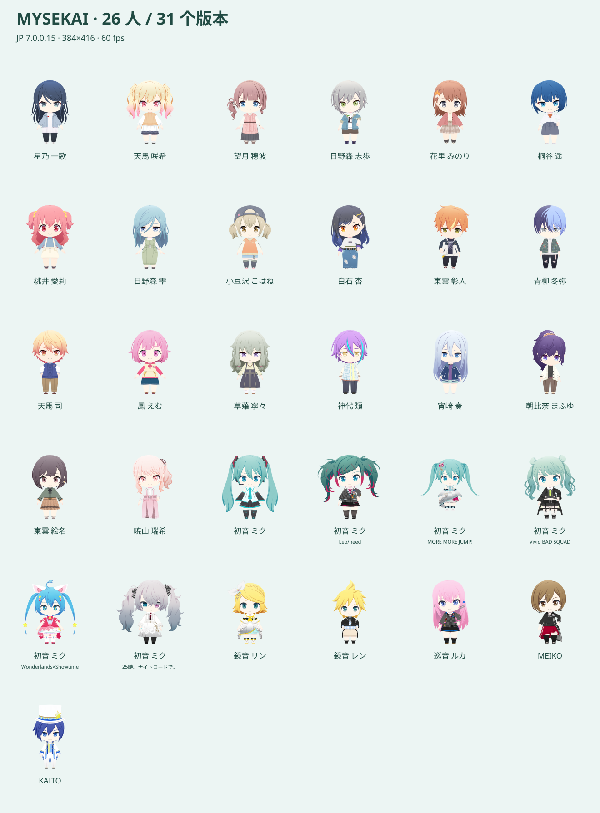
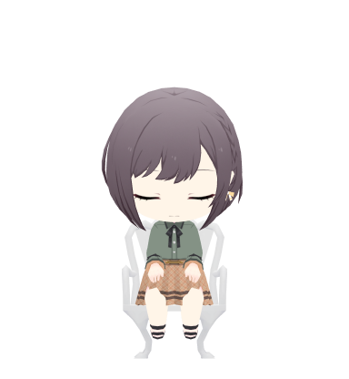

# PJSK-Pets-Pack

将 Project SEKAI 角色带到桌面的非官方主题包，基于 [Clawd on Desk](https://github.com/rullerzhou-afk/clawd-on-desk)。一套资源通过宿主接入 Codex、Claude Code 和 DeepSeek Harness。



## 特性

- **26 位角色、31 个模型版本**，包括 6 种初音未来形态；素材来自 JP 7.0.0.15 快照。
- **736 段动作**：呼吸、眨眼、行走、跑步、思考、庆祝、跳舞、表情及角色专属动作。
- **384×416、60 fps 透明动画**，WebP 质量 95，透明通道无损；角色与深睡椅子使用同一高清渲染流程。
- 任务状态、随机待机、点击、拖拽与休眠沿用 Clawd 的原生交互。出错和完成动作播放一次，再由宿主判断后续状态。
- 空闲约 2 分钟进入浅睡，约 10 分钟坐上白色花园椅休息；唤醒时起身。

动画由 JP 骨骼曲线插值采样；未复现 Unity 的 IK、布料和定制着色器。Mini Mode 与语音尚未提供。



## 安装

1. 安装并启动 **Clawd on Desk**，在设置中启用所用 harness 的集成，按宿主提示完成登录和 hook 信任。
2. 下载并解压 `mysekai-clawd-0.4.0.zip`。本地构建产物位于 `dist/releases`，校验值见同目录 `SHA256.json`。
3. 退出 Clawd，将包内 `themes` 下需要的 `pjsk-*` 文件夹复制到 Clawd 用户数据目录的 `themes` 文件夹。
4. 重新启动 Clawd，在 **设置 → 主题** 中选择角色。

Windows 默认主题目录为 `%APPDATA%\clawd-on-desk\themes`；若迁移了用户数据目录，请使用迁移后的实际目录。每个角色文件夹包含 `theme.json`、`source.json` 和 `assets`，可单独安装。升级同名主题前请备份个人修改并替换整个角色文件夹，以免留下旧资源。

发行包只包含统一的 Clawd 主题与来源记录，不附带宿主、账户信息或开发缓存。不再提供 Codex 原生 v1/v2 图集；Codex 的状态通过 Clawd 接入。

## 兼容性

验证基线为未修改的 Clawd **1.2.0**，具体 commit 见 `host/upstream.json`。主题使用 schemaVersion 1 与宿主原生动画 WebP。DeepSeek Harness 接入仍属宿主的 experimental 功能。

素材兼容性与 harness 事件接入分别验证，实际状态表现还取决于宿主版本、hooks 和权限配置。升级检查见 [上游维护](docs/UPSTREAM.md)。

## 开发

需要 Node.js ≥22.12、Git，以及用于素材处理的 Python 和 Pillow。原始 Unity bundles、转换模型和渲染缓存不进入 Git 仓库，也不包含在用户资源 ZIP 中；公开代码仅处理预先转换好的模型、贴图和动画数据，以及渲染、压缩、主题打包、预览和校验。成品 ZIP 单独作为 Release 附件。

在新检出中，先将资源 ZIP 解压到 `dist/mysekai-clawd`（其中应直接包含 `themes` 和 `pack.json`），再运行以下命令：

```powershell
npm run setup
npm run validate
npm test
npm start
```

`npm start` 安装尚不存在的主题并启动锁定宿主；已有偏好和同名主题保留。已有本地独立安装记录时会启动对应安装，`npm start -- --development` 则使用项目内开发宿主。

升级本地主题：先退出 Clawd，再运行 `node scripts/launch_host.mjs --upgrade`。脚本备份旧主题并保留设置。

| 路径 | 内容 |
|---|---|
| `dist/mysekai-clawd/themes` | 统一主题构建结果 |
| `web/export-settings.json`、`host/encoding.json` | 渲染与压缩参数 |
| `web` | 3D 素材预览、批量渲染与宿主预览 |
| `scripts/package_clawd.py` | 将高清帧编码为主题 |
| `scripts/build_release.py` | 生成单一资源 ZIP 与 SHA-256 |

重新渲染时，将预先转换好的模型、贴图、采样动画、目录索引和来源记录放入 `build/web`。输入格式见 [渲染输入](docs/RENDER_INPUT.md)。这些输入不随源码仓库分发。

执行 `npm run preview:prepare`，再启动 `python scripts/preview_server.py --port 8766`，可在本机打开 `http://127.0.0.1:8766/` 查看素材工作台，或 `/app/host-preview.html` 查看宿主渲染器预览。完成高清帧导出后运行 `python scripts/package_clawd.py`，验证通过后运行 `python scripts/build_release.py`。

## 素材与许可

本项目为非官方同人作品。游戏角色与素材的权利属于原权利人，代码或宿主许可不授予游戏素材的再分发权。素材版本、家具来源及第三方许可见 [来源说明](docs/SOURCES.md)；逐模型映射与资源溯源随包提供。
